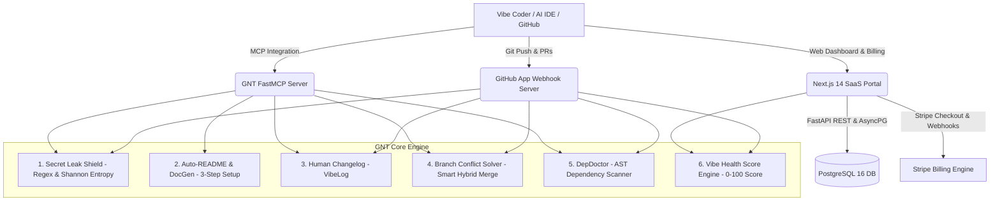

# 🛡️ GitHub Noob Toolkit (GNT)
### The Automated Protective Shield & Copilot for Beginners & Vibe Coders

[](file:///d:/mygithub/GNT/tests)
[](file:///d:/mygithub/GNT/frontend)
[](file:///d:/mygithub/GNT/backend)
[](file:///d:/mygithub/GNT/mcp_server)
[](LICENSE)

---

## 🌟 What is GitHub Noob Toolkit?

Modern developers, non-traditional programmers, and **"Vibe Coders"** build incredible software using AI tools (Cursor, Claude, ChatGPT, Windsurf). However, they frequently hit painful walls:
- 🚨 **Accidentally leaking OpenAI / Stripe / AWS secret keys** to public GitHub repos.
- ⚔️ **Terrifying merge conflicts** (`<<<<<<< HEAD`, `=======`) that freeze their workflow.
- 📦 **Undeclared dependencies** (`ModuleNotFoundError`) crashing cloud deployments.
- 📄 **Missing or cryptic READMEs** that confuse visitors.
- 🤯 **Intimidating Git jargon** full of commit hashes and rebases.

**GNT solves this entirely.** It acts as an automated protective copilot that intercepts leaks, explains changes in friendly plain English ("No-Jargon Mode"), heals branch conflicts in one click, and integrates directly into your AI IDE via **Model Context Protocol (FastMCP)**.

---

## 🏛️ Ecosystem Architecture



---

## ⚡ The 5 Core Safety Modules

### 1. Secret Leak Shield (`core/secrets.py`)
- Dual-layer inspection:
  - **Deterministic Regex:** Catches OpenAI (`sk-...`), Anthropic (`sk-ant-...`), Stripe (`sk_live_...`), AWS Access Keys (`AKIA...`), GitHub PATs, and SSH Private Keys.
  - **Shannon Entropy ($H \ge 4.0$):** Catches unidentified random high-entropy credentials assigned in code.
- **Tracked File Enforcement:** Detects if `.env`, `.env.local`, or `id_rsa` are staged in git diffs and guides the user to `.gitignore` without losing local files.

### 2. Auto-README & DocGen (`core/docgen.py`)
- Analyzes `package.json`, `requirements.txt`, and Dockerfiles.
- Generates beautiful, jargon-free READMEs with copy-pasteable 3-step setup guides and environment variable tables.

### 3. Human Changelog / VibeLog (`core/vibelog.py`)
- Parses git diffs and categorizes changes with emojis and empathy:
  - ✨ New Features & Upgrades
  - 🐛 Fixes & Polishing
  - ⚠️ Heads Up (Breaking Changes)
  - 🧹 Behind the Scenes (Maintenance)
- Includes a non-technical summary ("No-Jargon Mode").

### 4. Branch Conflict Solver (`core/conflicts.py`)
- Analyzes merge conflict markers (`<<<<<<< HEAD`, `=======`, `>>>>>>>`) in memory.
- Provides semantic understanding of both branches.
- Offers 3 safe resolution strategies:
  - **Smart Hybrid Merge (Recommended):** Combines distinct functions and imports without duplicate lines.
  - **Accept Ours:** Retains your local branch work.
  - **Accept Theirs:** Accepts the incoming PR changes.

### 5. DepDoctor (`core/dependencies.py`)
- Uses Python's Abstract Syntax Tree (`ast.parse`) and regex for JavaScript/TypeScript.
- Discovers libraries imported in code that were never added to `requirements.txt` or `package.json`.
- Auto-generates ready-to-commit manifest patches before your Vercel or Render deployment fails.

---

## 🔌 Model Context Protocol (FastMCP) Server

GNT includes a native FastMCP server ready for **Cursor**, **Claude Desktop**, and **Windsurf**.

### Configuration for Claude Desktop & Cursor
Add this block to your `claude_desktop_config.json` (Mac/Linux: `~/Library/Application Support/Claude/claude_desktop_config.json`, Windows: `%APPDATA%\Claude\claude_desktop_config.json`) or `.cursor/mcp.json`:

```json
{
  "mcpServers": {
    "gnt": {
      "command": "python",
      "args": ["-m", "mcp_server.server"],
      "env": {
        "PYTHONPATH": "d:/mygithub/GNT"
      }
    }
  }
}
```

### Exposed MCP Tools:
- `scan_code_for_leaks`: Scans snippets or git diffs for credentials.
- `generate_simple_readme`: Produces beginner-proof Markdown READMEs.
- `explain_diff`: Converts technical git diffs into human words.
- `resolve_conflict`: Dissolves `<<<<<<< HEAD` markers into clean code.
- `detect_missing_dependencies`: Finds undeclared imports and patches package manifests.
- `calculate_vibe_score`: Evaluates repository health from 0 to 100.

---

## 🚀 Quickstart & Local Setup

### 1. Prerequisites
- **Python 3.11+**
- **Node.js 20+**
- **Git**

### 2. Backend & Core Engine Setup
```bash
# Clone the repository
git clone https://github.com/your-username/GNT.git
cd GNT

# Create and activate virtual environment
python -m venv .venv
# Windows:
.\.venv\Scripts\activate
# Linux/macOS:
source .venv/bin/activate

# Install dependencies
pip install -r requirements.txt

# Run all 25 Pytest unit tests
pytest -v
```

### 3. Launch Backend API & GitHub Webhook Server
```bash
uvicorn backend.main:app --host 0.0.0.0 --port 8000 --reload
```
API docs available at: `http://localhost:8000/docs`

### 4. Launch Next.js Web Portal & Dashboard
```bash
cd frontend
npm install
npm run dev
```
Open your browser at: `http://localhost:3000`

---

## 🐳 Docker & Multi-Container Deployment

Run the entire production stack (PostgreSQL 16, Redis, Backend API, Next.js Web Portal) in one command:

```bash
# Copy and configure environment variables
cp .env.example .env

# Build and start all services
docker compose up --build -d
```

| Service | Container Name | Port | Description |
| :--- | :--- | :--- | :--- |
| **Frontend** | `gnt_frontend` | `3000` | Next.js 14 Web Portal & Dashboard |
| **Backend** | `gnt_backend` | `8000` | FastAPI SaaS Backend & GitHub App |
| **Database** | `gnt_postgres` | `5432` | PostgreSQL 16 with asyncpg |
| **Cache** | `gnt_redis` | `6379` | Redis 7 Background Queue |

---

## 💳 Stripe Monetization Setup

GNT comes with complete monetization built-in:
1. **Free Starter:** 3 public repos, basic leak shield, auto-README generator.
2. **Vibe Pro ($12/mo):** Unlimited private repos, Checks API PR blocker, 1-Click conflict solver, DepDoctor, and FastMCP IDE tools.
3. **Team Plan ($29/mo):** 10 team seats, organization secret vault, priority webhook SLA.

### Configuring Stripe:
1. Set `STRIPE_SECRET_KEY` and `STRIPE_PUBLISHABLE_KEY` in `.env`.
2. Create two recurring monthly products on your Stripe Dashboard:
   - `price_pro_monthly` -> Assign to `STRIPE_PRICE_ID_PRO`
   - `price_team_monthly` -> Assign to `STRIPE_PRICE_ID_TEAM`
3. Forward webhooks locally for testing:
   ```bash
   stripe listen --forward-to localhost:8000/api/billing/webhook
   ```

---

## 🤖 GitHub App Registration & Checks API Setup

1. Go to **GitHub Settings → Developer Settings → GitHub Apps → New GitHub App**.
2. **Webhook URL:** `https://your-domain.com/api/github/webhook`
3. **Webhook Secret:** Set a secure random string and match it in `GITHUB_WEBHOOK_SECRET`.
4. **Permissions:**
   - **Repository Permissions:**
     - `Checks`: Read & write (to create check runs and annotate lines)
     - `Pull requests`: Read & write (to post review comments)
     - `Contents`: Read-only (to read diffs and files)
5. Generate and download a **Private Key (`.pem`)** and set `GITHUB_PRIVATE_KEY` in `.env`.
6. Install the App on your repositories!

---

## 🧪 Operational Verification (`verify: PASS`)

Run the complete test suite to verify all 5 core modules and webhook handlers:

```powershell
.\.venv\Scripts\pytest.exe -v
```

Output:
```text
tests/test_billing.py::test_stripe_service_checkout_session_mock PASSED
tests/test_billing.py::test_stripe_webhook_completed_mock PASSED
tests/test_conflicts.py::test_conflict_solver_no_conflicts PASSED
tests/test_conflicts.py::test_conflict_solver_import_merging PASSED
tests/test_conflicts.py::test_conflict_solver_accept_ours PASSED
tests/test_dependencies.py::test_python_ast_import_extraction PASSED
tests/test_dependencies.py::test_audit_python_repository_missing_deps PASSED
tests/test_dependencies.py::test_generate_manifest_patch PASSED
tests/test_docgen.py::test_analyze_python_fastapi_project PASSED
tests/test_docgen.py::test_analyze_nextjs_project PASSED
tests/test_docgen.py::test_generate_readme PASSED
tests/test_github_app.py::test_verify_signature_valid PASSED
tests/test_github_app.py::test_verify_signature_invalid PASSED
tests/test_github_app.py::test_handle_unknown_event PASSED
tests/test_github_app.py::test_handle_push_event PASSED
tests/test_health_score.py::test_perfect_health_score PASSED
tests/test_health_score.py::test_health_score_with_leaked_secrets PASSED
tests/test_secrets.py::test_detect_openai_key PASSED
tests/test_secrets.py::test_detect_stripe_key PASSED
tests/test_secrets.py::test_detect_aws_access_key PASSED
tests/test_secrets.py::test_detect_forbidden_file_tracked PASSED
tests/test_secrets.py::test_shannon_entropy_calculation PASSED
tests/test_secrets.py::test_high_entropy_secret_assignment PASSED
tests/test_secrets.py::test_mask_secret PASSED
tests/test_vibelog.py::test_vibelog_features_and_fixes PASSED

======================= 25 passed in 1.71s ========================
```

---

## 📄 License

Distributed under the **MIT License**. Built with ❤️ for AI vibe coders and non-traditional developers.
