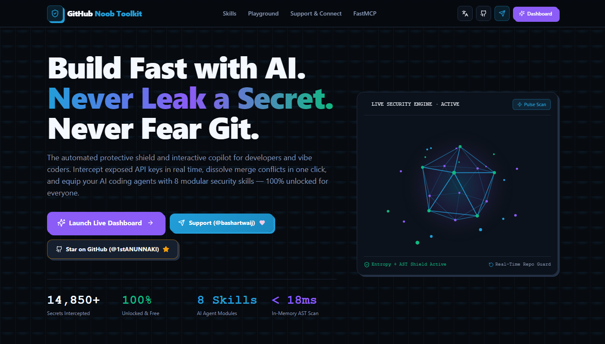
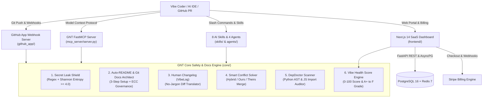

<p align="center">
  
</p>

# 🛡️ GitHub Noob Toolkit (GNT)

<div align="center">

[-2563EB?style=for-the-badge)](./README.md)
[-10B981?style=for-the-badge)](./README_AR.md)
[](./LICENSE)
[](./SECURITY.md)

[-10B981?style=for-the-badge&logo=pytest&logoColor=white)](./tests)
[](./skills)
[](./AGENTS.md)
[](./mcp_server)

### 🛠️ Built With (Languages & Technologies)


**The Automated Protective Shield, Documentation Architect & FastMCP Copilot for Beginners, AI Vibe Coders, and Engineering Teams.**

[🇬🇧 English (Current)](./README.md) · [🇸🇦 الدليل العربي الشامل (`README_AR.md`)](./README_AR.md) · [🤖 Agent & Skill Catalog (`AGENTS.md`)](./AGENTS.md) · [🎯 Use-Cases Playbook](./docs/use-cases/USE_CASES_PLAYBOOK.md) · [🛠️ Contributing](./CONTRIBUTING.md) · [🛡️ Security Policy](./SECURITY.md) · [🔧 Troubleshooting](./TROUBLESHOOTING.md)

</div>

---

> [!WARNING]
> **Official Sources & Zero-Secret Policy:** Always use the canonical repository [`1stANUNNAKI/GNT`](https://github.com/1stANUNNAKI/GNT). Never hardcode real API keys, PATs, or Stripe secrets into `.env` or `mcp.json` files—GNT's `secret-leak-shield` enforces deterministic regex and Shannon Entropy ($H \ge 4.0$) scanning across all commits. See [`SECURITY.md`](./SECURITY.md) for supply-chain and vulnerability reporting rules.

---

## 🌟 1. Why GitHub Noob Toolkit (GNT)?

Your AI coding assistant can write code fast, but **GNT gives you an automated protective engineering harness**: it intercepts leaked API keys before they hit GitHub, dissolves terrifying merge conflicts in one click, detects undeclared imports before cloud deployments fail, translates cryptic diffs into plain English, and upgrades any repository to 100% GitHub Community Health compliance.

```text
scan (Secrets & AST Deps) -> heal (Merge Conflicts) -> document (ECC Docs & VibeLog) -> verify (0-100 Vibe Score) -> deploy
```

| Included Surface | Count | What It Gives You |
| :--- | :-: | :--- |
| **AI Agent Skills (`skills/`)** | `8 skills` | On-demand workflows for secret scanning, ECC documentation (`git-docs-architect`), conflict healing, AST dependency auditing, and MCP bridging |
| **Specialized Agents (`agents/`)** | `4 agents` | Dedicated subagents (`gnt-security-auditor`, `gnt-conflict-healer`, `gnt-docs-architect`, `gnt-dep-doctor`) |
| **Slash Commands (`commands/`)** | `5 commands` | Instant entry points: `/gnt-scan`, `/gnt-docs`, `/gnt-heal`, `/gnt-deps`, `/gnt-score` |
| **Core Safety Engines (`core/`)** | `6 modules` | Zero-jargon Python engines for secrets, README docgen, VibeLog diffs, conflict solving, AST deps, and 0–100 scoring |
| **FastMCP Server (`mcp_server/`)** | `6 MCP tools` | Native Model Context Protocol tools for Claude Code, Cursor, Windsurf, and Antigravity |
| **Full-Stack SaaS & GitHub App** | `Production` | FastAPI backend, Next.js 14 dashboard, GitHub Checks API webhook blocker, and Stripe billing |
| **Automated Test Suite (`tests/`)** | `25 tests` | 100% passing unit & integration test suite (`pytest -v`) |

---

## 🚀 2. Start Using GNT (Task-to-Skill Router)

Start with the exact workflow you need—no need to read the entire codebase first:

| What You Are Doing | Start Here (Command / Skill) | Agent / Engine Invoked |
| :--- | :--- | :--- |
| **Checking code or diffs for leaked API keys / `.env` files** | `/gnt-scan` or [`secret-leak-shield`](./skills/secret-leak-shield/SKILL.md) | `gnt-security-auditor` (`core/secrets.py`) |
| **Upgrading a repo with full ECC-style GitHub docs & tabs** | `/gnt-docs` or [`git-docs-architect`](./skills/git-docs-architect/SKILL.md) | `gnt-docs-architect` (`core/docgen.py`) |
| **Fixing `<<<<<<< HEAD` Git merge conflicts safely** | `/gnt-heal` or [`smart-conflict-solver`](./skills/smart-conflict-solver/SKILL.md) | `gnt-conflict-healer` (`core/conflicts.py`) |
| **Preventing `ModuleNotFoundError` before cloud deploy** | `/gnt-deps` or [`dep-doctor-scanner`](./skills/dep-doctor-scanner/SKILL.md) | `gnt-dep-doctor` (`core/dependencies.py`) |
| **Generating a beginner-friendly 3-step `README.md`** | [`auto-readme-docgen`](./skills/auto-readme-docgen/SKILL.md) | `gnt-docs-architect` (`core/docgen.py`) |
| **Translating a complex `git diff` into plain English** | [`vibelog-human-changelog`](./skills/vibelog-human-changelog/SKILL.md) | `core/vibelog.py` (`explain_diff` MCP) |
| **Auditing overall repository health (`0–100` Grade `A+`..`F`)** | `/gnt-score` or [`vibe-health-scorer`](./skills/vibe-health-scorer/SKILL.md) | `core/health_score.py` (`calculate_vibe_score`) |
| **Connecting GNT tools directly into Cursor / Claude Code** | [`fastmcp-ide-bridge`](./skills/fastmcp-ide-bridge/SKILL.md) | `mcp_server/server.py` |

> 📖 **Want detailed step-by-step walkthroughs?** Read the [**Real-World Use-Cases Playbook (`docs/use-cases/USE_CASES_PLAYBOOK.md`)**](./docs/use-cases/USE_CASES_PLAYBOOK.md).

---

## 🏛️ 3. Ecosystem Architecture



---

## 🧩 4. Catalog of the 8 Bundled AI Skills (`skills/`)

All 8 skills follow the `agentskills.io` & Claude Code specification and are mirrored in `.agents/skills/` for automatic multi-harness discovery:

| # | Skill Identifier | Skill Guide | Underlying Engine | Summary |
| :-: | :--- | :---: | :--- | :--- |
| **01** | **`git-docs-architect`** | [📄 `SKILL.md`](./skills/git-docs-architect/SKILL.md) | `core/docgen.py` + Templates | Builds the complete 9-file ECC-grade GitHub documentation & Community Health suite (`README`, `SECURITY`, `CONTRIBUTING`, `CODE_OF_CONDUCT`, `LICENSE`, `AGENTS`) |
| **02** | **`secret-leak-shield`** | [📄 `SKILL.md`](./skills/secret-leak-shield/SKILL.md) | [`core/secrets.py`](./core/secrets.py) | Dual-layer Regex + Shannon Entropy ($H \ge 4.0$) credential scanner and `.env` staging blocker |
| **03** | **`auto-readme-docgen`** | [📄 `SKILL.md`](./skills/auto-readme-docgen/SKILL.md) | [`core/docgen.py`](./core/docgen.py) | Auto-detects project stack (`FastAPI`, `Next.js`, `Docker`) and generates jargon-free 3-step `README.md` guides |
| **04** | **`vibelog-human-changelog`** | [📄 `SKILL.md`](./skills/vibelog-human-changelog/SKILL.md) | [`core/vibelog.py`](./core/vibelog.py) | Parses `git diff` hunks into categorized release notes (`✨ Features`, `🐛 Fixes`, `⚠️ Breaking`) with a No-Jargon summary |
| **05** | **`smart-conflict-solver`** | [📄 `SKILL.md`](./skills/smart-conflict-solver/SKILL.md) | [`core/conflicts.py`](./core/conflicts.py) | Dissolves `<<<<<<< HEAD` markers in memory via Smart Hybrid Merge, Accept Ours, or Accept Theirs |
| **06** | **`dep-doctor-scanner`** | [📄 `SKILL.md`](./skills/dep-doctor-scanner/SKILL.md) | [`core/dependencies.py`](./core/dependencies.py) | Uses `ast.parse` to find undeclared PyPI/npm imports and generates manifest patches |
| **07** | **`vibe-health-scorer`** | [📄 `SKILL.md`](./skills/vibe-health-scorer/SKILL.md) | [`core/health_score.py`](./core/health_score.py) | Computes a `0–100` repository health score and `A+`..`F` grade across security, docs, deps, and conflicts |
| **08** | **`fastmcp-ide-bridge`** | [📄 `SKILL.md`](./skills/fastmcp-ide-bridge/SKILL.md) | [`mcp_server/server.py`](./mcp_server/server.py) | Exposes all 6 GNT engines as native Model Context Protocol tools inside your AI IDE |

---

## ⚡ 5. Guided Setup & Installation

### Option A: Install GNT Skills & Agents into Your AI Harness (Claude Code, Cursor, Antigravity, OpenCode, Codex)

```bash
git clone https://github.com/1stANUNNAKI/GNT.git
cd GNT

# Copy skills & agents into Claude Code / Antigravity / OpenCode
cp -r skills/* ~/.claude/skills/
cp agents/*.md ~/.claude/agents/
cp commands/*.md ~/.claude/commands/
```

<details>
<summary><strong>Configure FastMCP Server in Cursor, Claude Desktop, or Windsurf (<code>mcp.json</code>)</strong></summary>

Add this entry to your `.cursor/mcp.json` or `claude_desktop_config.json`:

```json
{
  "mcpServers": {
    "gnt": {
      "command": "python",
      "args": ["-m", "mcp_server.server"],
      "env": {
        "PYTHONPATH": "/absolute/path/to/GNT"
      }
    }
  }
}
```
</details>

### Option B: Local Python & Next.js Development Setup

```bash
# 1. Create and activate virtual environment
python -m venv .venv
source .venv/bin/activate  # Windows PowerShell: .\.venv\Scripts\Activate.ps1

# 2. Install backend & core dependencies
pip install -r requirements.txt

# 3. Run the 25-test verification suite
pytest -v

# 4. Launch FastAPI Backend & Webhook Server (http://localhost:8000/docs)
uvicorn backend.main:app --host 0.0.0.0 --port 8000 --reload
```

<details>
<summary><strong>Launch Next.js 14 Web Dashboard & Docker Compose Stack</strong></summary>

```bash
# Launch Next.js 14 Frontend (http://localhost:3000)
cd frontend
npm install
npm run dev

# Or run the full 4-container stack (Frontend, Backend, PostgreSQL 16, Redis 7)
cp .env.example .env
docker compose up --build -d
```
</details>

---

## 📂 6. What's Inside (Annotated Repository Tree)

```text
GNT/
├── README.md                  # Primary Documentation (English — ECC 10-Zone Standard)
├── README_AR.md               # Secondary Documentation (Complete Arabic Translation)
├── AGENTS.md                  # Agent-First Instructions, Skills Matrix & Security Rules
├── CODE_OF_CONDUCT.md         # Contributor Covenant v2.0 + 4-Stage Enforcement Ladder
├── CONTRIBUTING.md            # Contributor Guide for Skills, Agents, Commands & Core Modules
├── SECURITY.md                # Vulnerability Reporting SLA, Supply-Chain & Secrets Policy
├── LICENSE                    # Official MIT License
├── CHANGELOG.md               # Semantic Version History & Release Audit
├── TROUBLESHOOTING.md         # Symptom -> Cause -> Solution Diagnostic Guide
├── skills/                    # 8 Modular AI Agent Skills (SKILL.md)
│   ├── git-docs-architect/    # Full ECC-grade GitHub Documentation & Governance Builder
│   ├── secret-leak-shield/    # Dual-layer Regex + Shannon Entropy Secret Scanner
│   ├── auto-readme-docgen/    # 3-Step Beginner-Friendly README Generator
│   ├── vibelog-human-changelog/ # No-Jargon Git Diff & Release Translator
│   ├── smart-conflict-solver/ # 3-Strategy Branch Merge Conflict Healer
│   ├── dep-doctor-scanner/    # AST Undeclared Dependency Scanner & Manifest Patcher
│   ├── vibe-health-scorer/    # 0-100 Repository Health & Grade Calculator
│   └── fastmcp-ide-bridge/    # Model Context Protocol Server Integration Guide
├── .agents/skills/            # Cross-Harness Skill Discovery Mirror
├── agents/                    # 4 Specialized Subagent Definitions (*.md)
├── commands/                  # 5 Slash Commands (/gnt-scan, /gnt-docs, /gnt-heal, /gnt-deps, /gnt-score)
├── docs/use-cases/            # Real-World Engineering Use-Cases Playbook
├── core/                      # 6 Core Python Engines (secrets, docgen, vibelog, conflicts, dependencies, health_score)
├── mcp_server/                # FastMCP Server (server.py)
├── github_app/                # GitHub App Auth, Checks API & PR Webhook Handler
├── backend/                   # FastAPI REST API, AsyncPG Database & Stripe Billing
├── frontend/                  # Next.js 14 App Router SaaS Portal & Interactive Playground
└── tests/                     # 25 Pytest Unit & Integration Tests
```

---

## 🧪 7. Operational Verification (`verify: PASS`)

Run the complete test suite to verify all core modules, webhook signature validators, and billing mocks:

```bash
pytest -v
```

```text
tests/test_billing.py::test_stripe_service_checkout_session_mock PASSED
tests/test_billing.py::test_stripe_webhook_completed_mock PASSED
tests/test_conflicts.py::test_conflict_solver_no_conflicts PASSED
tests/test_conflicts.py::test_conflict_solver_import_merging PASSED
tests/test_conflicts.py::test_conflict_solver_accept_ours PASSED
tests/test_dependencies.py::test_python_ast_import_extraction PASSED
tests/test_dependencies.py::test_audit_python_repository_missing_deps PASSED
tests/test_dependencies.py::test_generate_manifest_patch PASSED
tests/test_docgen.py::test_analyze_python_fastapi_project PASSED
tests/test_docgen.py::test_analyze_nextjs_project PASSED
tests/test_docgen.py::test_generate_readme PASSED
tests/test_github_app.py::test_verify_signature_valid PASSED
tests/test_github_app.py::test_verify_signature_invalid PASSED
tests/test_github_app.py::test_handle_unknown_event PASSED
tests/test_github_app.py::test_handle_push_event PASSED
tests/test_health_score.py::test_perfect_health_score PASSED
tests/test_health_score.py::test_health_score_with_leaked_secrets PASSED
tests/test_secrets.py::test_detect_openai_key PASSED
tests/test_secrets.py::test_detect_stripe_key PASSED
tests/test_secrets.py::test_detect_aws_access_key PASSED
tests/test_secrets.py::test_detect_forbidden_file_tracked PASSED
tests/test_secrets.py::test_shannon_entropy_calculation PASSED
tests/test_secrets.py::test_high_entropy_secret_assignment PASSED
tests/test_secrets.py::test_mask_secret PASSED
tests/test_vibelog.py::test_vibelog_features_and_fixes PASSED

======================= 25 passed in 1.71s ========================
```

---

## ⚖️ 8. License

Distributed under the **MIT License** — see [`LICENSE`](./LICENSE) for full details.
