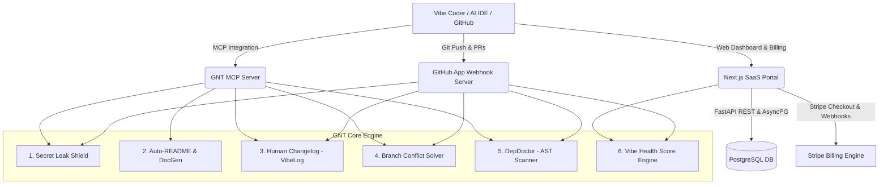

# 🏛️ وثيقة المعمارية الشاملة · GitHub Noob Toolkit (GNT)

> **الإصدار:** 1.0.0-PROD  
> **الحالة:** معتمد للنشر والتنفيذ الفوري  
> **المصادقة المعمارية:** نظام مجلس الحوكمة (Majlis Council System-2)

---

## 1. الرؤية والرسالة المعمارية (Vision & Mission)
منصة **"GitHub Noob Toolkit" (GNT)** هي درع حماية ومساعد أوتوماتيكي ذكي تم تصميمه خصيصاً للمبرمجين المبتدئين، والمبرمجين غير التقليديين، ومطوري نمط "Vibe Coders" الذين يعتمدون على الذكاء الاصطناعي لتوليد البرمجيات ولكنهم يواجهون عوائق معقدة في أوامر Git، وإدارة تعارضات الفروع (Merge Conflicts)، وتسريب مفاتيح الأسرار، وتوثيق المشاريع.

تعتمد المنصة فلسفة **"No-Jargon Philosophy" (البرمجة بدون مصطلحات معقدة)**: لا توبيخ للمطور على الأخطاء، بل شرح مبسط فوري، وأزرار إصلاح بنقرة واحدة (One-Click Fixes)، وترجمة لغات Git المعقدة إلى لغة إنسانية مفهومة ومشجعة.

---

## 2. المكونات الأربعة الموحدة للنظام (System Pillars)

### 1. المحرك الأساسي (GNT Core Engine - Python 3.11+)
- **Secret Leak Shield (`core/secrets.py`):**
  - فحص الـ Diffs والملفات بواسطة أنماط Regex دقيقة لكشف مفاتيح OpenAI, Stripe, AWS, GitHub PATs, Private Keys, Slack tokens, ومفاتيح التشفير العامة ذات الإنتروبيا العالية (Shannon Entropy > 4.5).
  - فحص أمني لملفات التتبع لمنع رفع ملفات `.env` ومجلدات الحزم المحظورة ومطابقة قواعد `.gitignore`.
- **Auto-README & DocGen (`core/docgen.py`):**
  - تحليل ملفات التبعيات (`package.json`, `requirements.txt`, `pyproject.toml`, `Dockerfile`) وتوليد توثيق نظيف وخالٍ من التعقيد، يتضمن خطوات تشغيل بنسخ ولصق سريع، وقوالب متغيرات البيئة.
- **Human Changelog / VibeLog (`core/vibelog.py`):**
  - تحويل فروقات Git (Diffs) المعقدة إلى سجل تغييرات بشري مشجع:
    - ✨ مميزات جديدة (Features)
    - 🐛 إصلاحات سريعة (Fixes)
    - ⚠️ تنبيهات التوافق (Breaking Changes)
    - 🧹 ترتيب وتنظيف الكود (Chores)
- **Branch Conflict Solver (`core/conflicts.py`):**
  - تحليل علامات التعارض (`<<<<<<<`, `=======`, `>>>>>>>`) داخل الذاكرة وتفكيك كود الطرفين، وتقديم خيارات حل واضحة (قبول تعديلاتنا، قبول تعديلاتهم، أو دمج هجين ذكي) مع تصدير رقعة (Patch) جاهزة للتطبيق.
- **DepDoctor (`core/dependencies.py`):**
  - استخدام شجرة التحليل النحوي المجردة (AST - Abstract Syntax Trees) للكشف عن المكتبات المستوردة برمجياً غير المسجلة في ملفات التبعيات وحقنها تلقائياً.
- **Vibe Health Score Engine (`core/health_score.py`):**
  - مؤشر قياس الجودة (0-100) يقيم سلامة المستودع برمجياً وأمنياً وتوثيقياً.

### 2. خادم تطبيق جيت هاب (GitHub App Webhook & Checks Server)
- مبني على **FastAPI**.
- تحقق مشدد من صحة التوقيع الرقمي للويبهوك بواسطة HMAC SHA-256 (`X-Hub-Signature-256`).
- مصادقة كاملة مع واجهات GitHub REST API عبر تشفير RSA Private Key وتوليد رموز JWT لإنشاء Installation Access Tokens قصيرة الأجل.
- تكامل تام مع **Checks API**: حظر تلقائي للـ Pull Requests التي تحتوي على تسريبات خطيرة أو ملفات محظورة مع إرفاق Annotations برقم السطر ورسائل نصيحة لطيفة.

### 3. خادم بروتوكول سياق النماذج (Model Context Protocol - FastMCP Server)
- خادم **FastMCP** بلغة بايثون يتيح تكاملاً أصيلاً مع بيئات التطوير مثل Cursor و Claude Desktop:
  - أداة `scan_code_for_leaks`
  - أداة `generate_simple_readme`
  - أداة `explain_diff`
  - أداة `resolve_conflict`
  - أداة `detect_missing_dependencies`

### 4. بوابة المنصة ولوحة التحكم (SaaS Web Portal & Dashboard)
- **الواجهة الأمامية (Frontend):**
  - مبنية على Next.js 14+ (App Router) مع Tailwind CSS و Lucide Icons.
  - هوية بصرية متميزة بأسلوب **Dark Cyber-Minimalism / Neo-Brutalist** مستوحاة من بيئات المطورين الليلية:
    - خلفيات: `#0D1117` و `#161B22`
    - حواف وإطارات: `#30363D`
    - ألوان إشارات الحالة: بنفسجي كهربائي `#8B5CF6`، أخضر الزمرد `#10B981`، برتقالي التحذير `#F59E0B`، وأحمر الخطر `#EF4444`.
  - لوحة تحكم تفاعلية تتضمن مؤشر Vibe Health Score التفاعلي، وتبويبات الدرع الأمني، وحلال التعارضات، وفاحص التبعيات، وسجل العمليات، ومبدل "الوضع الخالي من المصطلحات" (No-Jargon Mode).
- **الواجهة الخلفية (Backend API):**
  - خادم FastAPI مستقل مدعوم بـ SQLAlchemy 2.0 Async و PostgreSQL.
- **محرك الاشتراكات والربحية (Monetization):**
  - تكامل متقدم مع Stripe Checkout و Stripe Webhooks لدعم خطط الاشتراك الثلاث (Free, Pro, Team).

---

## 3. معايير النشر والأمان (DevOps & Zero Trust)
- **حاويات Docker متعددة المراحل (Multi-stage builds)** لتحقيق أصغر حجم وأعلى أمان ممكن.
- **Docker Compose** موحد يشمل خادم الواجهة، الواجهة الخلفية، قاعدة بيانات PostgreSQL، و Redis.
- مسار أتمتة مستمر **GitHub Actions** للفحص، واختبارات الوحدات (Pytest)، وبناء الصور وتجهيز النشر.
